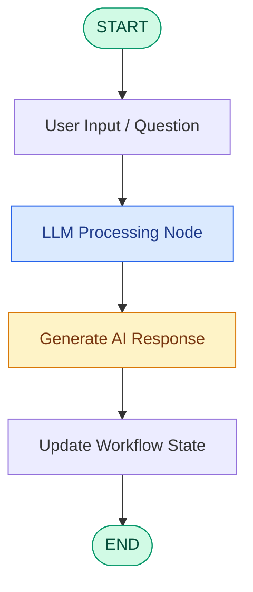

# 🤖 Simple LLM Workflow Using LangGraph

<p align="center">
  <b>Exploring LLM Integration, Graph-Based Architecture & Sequential Workflow Orchestration</b>
</p>

<p align="center">
  
  
  
  
  
</p>

---

## 📌 1. Project Overview

This project demonstrates how to build a **simple LLM-powered sequential workflow using LangGraph**.

The application accepts a user's question, processes it through a Large Language Model (LLM), and generates a response through a graph-based execution pipeline.

The primary objective is to understand how LLMs can be integrated into structured workflows using LangGraph, rather than relying on a simple standalone LLM API call.

This project introduces fundamental concepts required to build more advanced Agentic AI applications.

### Key Learning Objectives

- Understanding graph-based workflow orchestration.
- Integrating Large Language Models (LLMs) into Python applications.
- Managing shared state across workflow nodes.
- Understanding sequential execution and graph transitions.
- Working with LangGraph's `StateGraph` architecture.
- Handling LLM API errors and rate limits.

## ⚙️ 2. Workflow Architecture

The application follows a sequential execution pipeline:



### Workflow Execution

| Stage | Component | Function |
|---|---|---|
| 1 | User Input | Accepts a question or prompt |
| 2 | LLM Node | Processes the input using an LLM |
| 3 | Response Generation | Generates the requested answer |
| 4 | State Update | Stores the generated response |
| 5 | Final Output | Returns the workflow result |

## 🧠 3. Understanding LangGraph Components

### A. State Management

State maintains the information shared between different nodes during workflow execution.

LangGraph supports state schemas using Python's `TypedDict`.

Conceptual example:

```python
from typing import TypedDict

class LLMState(TypedDict):
    question: str
    response: str
```

### B. Nodes

Nodes are Python functions responsible for executing individual tasks.

In this project, the primary node is responsible for sending the user's question to the LLM and generating a response.

### C. Edges

Edges define the execution path between different nodes.

For a sequential workflow:

```text
START
  |
  v
LLM Processing Node
  |
  v
Response Generation
  |
  v
END
```

### D. StateGraph

`StateGraph` is used to construct the workflow by combining:

- State schema
- Processing nodes
- Directed edges
- Execution transitions

## 💻 4. Core Implementation Concepts

### Import Required Libraries

```python
from langgraph.graph import StateGraph, START, END
from typing import TypedDict
```

### Define the State

```python
class LLMState(TypedDict):
    question: str
    response: str
```

### Build the Graph

```python
graph = StateGraph(LLMState)

# Register processing nodes
graph.add_node("llm_node", generate_response)

# Define workflow transitions
graph.add_edge(START, "llm_node")
graph.add_edge("llm_node", END)

# Compile the graph
workflow = graph.compile()
```

*Note: The code snippets illustrate the core architecture. Refer to the Jupyter Notebook for the complete implementation and actual node definitions.*

## 🚀 5. Sample Execution

The workflow accepts a question through its initial state.

```python
initial_state = {
    "question": "How far is the moon from the earth?"
}

final_state = workflow.invoke(initial_state)

print(final_state)
```

### Expected Output

The workflow returns a dictionary containing the input question and the LLM-generated response.

Example response:

```text
The average distance between the Earth
and the Moon is approximately 384,400 km.
```

*The actual response depends on the selected LLM and its generated output.*

## 📊 6. Graph Visualization

LangGraph provides visualization utilities to inspect the workflow architecture.

To visualize the graph directly in Jupyter Notebook:

```python
print(workflow.get_graph().draw_ascii())
```

This helps understand the sequence in which nodes are executed and how different components are connected.

## 🛠️ 7. Technology Stack

| Technology | Purpose |
|---|---|
| Python | Core programming language |
| LangGraph | Graph-based workflow orchestration |
| OpenAI API | Large Language Model integration |
| TypedDict | State schema definition |
| Jupyter Notebook | Interactive development |
| VS Code | Development environment |

## 📂 8. Repository Structure

```text
llm_workflow/
│
├── 2_simple_llm_workflow.ipynb
├── README.md
└── requirements.txt  (optional)
```

## 🔧 9. Getting Started

### Step 1: Clone the Repository

```bash
git clone https://github.com/priyanshukr001/llm_workflow.git
```

### Step 2: Navigate to the Project

```bash
cd llm_workflow
```

### Step 3: Create a Virtual Environment

```bash
python3 -m venv .venv
```

Activate it on Mac/Linux:

```bash
source .venv/bin/activate
```

### Step 4: Install Dependencies

```bash
python -m pip install langgraph openai jupyter ipykernel
```

Install `python-dotenv` as well if the notebook uses a `.env` file:

```bash
python -m pip install python-dotenv
```

### Step 5: Configure API Key

Create a `.env` file locally:

```env
OPENAI_API_KEY=your_api_key_here
```

Never upload this file or expose your API key on GitHub.

### Step 6: Launch the Notebook

```bash
jupyter notebook 2_simple_llm_workflow.ipynb
```

## 🎯 10. Key Learning Outcomes

Through this project, I explored:

- Integrating LLMs into LangGraph workflows.
- Understanding sequential graph execution.
- Defining structured state using `TypedDict`.
- Creating modular processing nodes.
- Connecting nodes through directed edges.
- Compiling and invoking graph-based applications.
- Understanding the foundation of LLM-powered applications.

## 🔮 11. Future Scope

This basic LLM workflow serves as a foundation for more advanced Agentic AI systems.

Potential enhancements include:

- Conditional edges and dynamic routing.
- Tool calling and external API integration.
- Retrieval-Augmented Generation (RAG).
- Conversation memory and persistent state.
- Multi-agent collaboration.
- Human-in-the-loop execution.
- Error handling, retries, and model evaluation.

## 👨‍💻 Author

**Priyanshu Kumar**

Delhi Technological University (DTU)

GitHub: [@priyanshukr001](https://github.com/priyanshukr001)

---

⭐ If you find this project useful, feel free to explore the notebook and follow my journey into Generative AI, LangGraph, and Agentic AI development.
